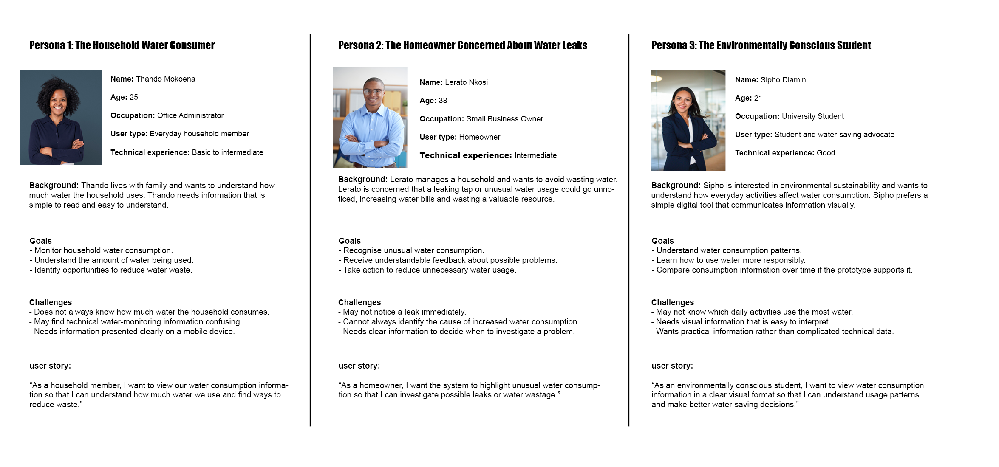
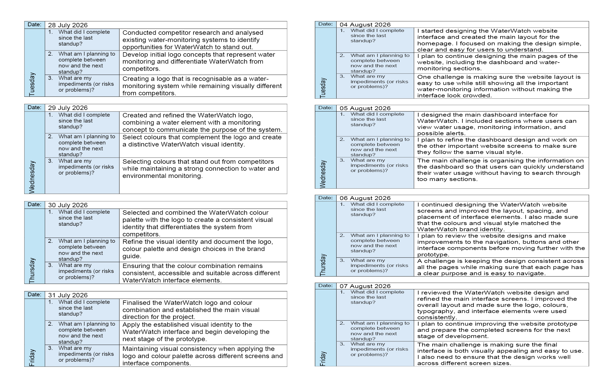

# **GitHub Portfolio - WIL Projects - WaterWatch System**

## **Agile Team Charter**

### **Purpose**
The goal of WaterWatch is to create a user-focused water monitoring system that solves the problem of not seeing how much water is being used at home in Cape Town. The project is about giving households access to information about how much water they use. This can help people understand how they use water find leaks and make choices about saving water.

The team wants to build a working model that's possible to make and fits the situation. This model will show how sensors and a phone app can work together to give information about water use. Of only thinking about how to build a product the team wants to bring together what people need what problems they have, how the app should look and how it should work into one complete plan.

The project will use a step-by-step and team-based way of working. Ideas, choices about design and what the system can do will be checked often during the building process. This will make sure the result matches what people need and what the project wants to achieve.

### **Vision Statement**
The idea behind WaterWatch is to help people make choices about using water by giving them easy-to-understand and quick information about how much they use. By turning data about water use into ideas, the system hopes to get people to use water more carefully, know more about how they use water and to help save water.

## **Project Objectives**
### **The team will pursue the following objectives:**
 -	Look into the problems that people face when checking how water they use by doing research that is real and looking at other studies.
 -	Find out what people need and take what was learned from the research to make rules for what the product should do.
 -	Come up with a way to check water flow without making changes using a special kind of sensor that clamps onto pipes.
 -	Make a phone app that's easy to use and shares water use information clearly.
 -	Show how the sensor and the phone app would work together as part of the system.
 -	Improve the things that the project will give out by checking and getting feedback again.
 -	Check if the idea works for the problem that people need and the technical limits that are there.

## **Definition of Success**
### **The success of WaterWatch will be evaluated against the following criteria:**
 - WaterWatch must clearly connect the household water monitoring problem to its features. Everyone looking at the design should see this link.
 -	I think research findings must give a basis for spotting user needs, setting clear requirements, and deciding on design choices. Research‑informed development must stand up to scrutiny.
 -	WaterWatch must show a prototype or a clear conceptual demonstration that respects the technical strengths and limits of the chosen sensor and the application. Technical feasibility must be clear and honest.
 -	WaterWatch’s mobile interface must display information in a way that's easy to access and easy to understand so users can read water consumption data and act on it. User‑centred design must help every user.
 -	I think research, requirements, system design, interface prototypes, and technical explanations must all tie together for WaterWatch. Integration of deliverables must flow smoothly.
 -	Feedback and review activities guide tweaks to WaterWatch deliverables. Iterative improvement must keep the work on track.

## **Product Scope and Responsibilities**
### **The principal product responsibilities are:**
 -	**Water flow monitoring:** Think up a clamp on sensor idea that watches water flow without digging into pipes. The feasibility of this idea must be checked against the tech tools we have. The limits of the project. Water flow monitoring must be doable.
 -	**Mobile application interface:** Create an easy to use interface that shows water consumption data and helps users understand it. The mobile application interface must be clear.
 -	**Leak detection:** Build or show the logic that spots water flow patterns that might mean a leak. Leak detection must work when good data is available. Leak detection logic must be tested.
 -	**Estimated water costs:** Look at how the water usage data could become an estimated household bill using the tariff rules and calculation assumptions. Estimated water costs must be realistic.
 -	**System integration:** Write or show how the sensor, the data processor, and the mobile interface will work together. System integration must be clear.
 -	**Prototype evaluation:** Check the proposed solution against the research results, the functional needs, and the agreed project goals. Prototype evaluation must confirm everything fits.

## **Team Roles and Responsibilities**
| Team Members | Agile Role | Responsibilities |
|---|---|---|
|Matimu Mabunda|Project Manager (Scrum Master) | Helps make sure that everyone follows the plan, keeps track of what needs to be done, looks at the task list, finds problems and helps fix them, makes sure people talk to each other and work together, and keeps finding ways to do better.
Kamvelihle Mqadi | Product Owner & Research Analyst | Does hand and second-hand research, investigates what users want, turns what is learned into what the product needs, keeps the list of things to build up to date, and helps decide what is most important for the product.
Marco Julian Human | Frontend Developer & UI Designer | Creates the look of the app, builds models that show how the app works, makes sure the app is easy for everyone to use, and works with the person who builds the back part of the app.
Thapelo Masingi | Backend Developer | Checks how the technology works, builds the way data is handled and stored investigates how sensors connect to the app. Makes sure everything is safe, fast, monitored, and can send alerts when needed.

## **Shared Responsibilities**
### **All members are expected to:**
 - Contribute to planning, reviews and agreed team discussions.
 - Communicate progress, dependencies and potential delays.
 -	Review relevant materials. Provide constructive feedback.
 -	Maintain project documentation.
 -	Support decisions with research, technical reasoning or user requirements.
 -	Participate in identifying improvements to the team’s working practices.

### **Accountability and Role Boundaries**
The team will use the agreed role allocation to set ownership of tasks and to encourage collaboration across disciplines. For example, the frontend developers and the backend developers must coordinate their work so that the proposed data structure and interface requirements are compatible.

I think the Product Owner is responsible for product priorities and value, while the Scrum Master facilitates the team’s agreed process and helps address obstacles. The Project Manager designation reflects the team’s assigned coordination responsibility. These responsibilities are defined for this project. Should not be interpreted as a claim that the Project Manager is a formal Scrum role.

---

## **Team Core Values and Agile Principles**

### **Accountability**
Each team member is responsible for the quality, completion, and communication of their assigned work. They must take ownership of their tasks, report problems early, and let others know if deadlines might be delayed. This helps keep things open and clear. It lets the team act on issues before they cause problems with the project.

### **Transparency**
Project progress, task status, challenges, and decisions should be easy for everyone to see. We’ll use agreed-upon communication channels and the project task board to share this. Keeping information accurate helps reduce confusion, supports teamwork and lets members spot when one task depends on another.

### **Respect**
Team members must value perspectives, skills, and ways of working. Listening carefully, giving feedback that helps, and talking professionally will support decisions. It also helps the team handle disagreements in a useful way.

### **Reliability**
Members are expected to keep their promises and do work that meets the project’s quality standards. When one task depends on another person’s work the team members involved must coordinate. This helps avoid delays that could happen if no one is checking in.

### **Improvement**
The team will look at how it works find things that're hard and think about changes that could help. Feedback and group discussions after stages will help us learn what went well and what didn’t. We’ll agree on steps to make things better.

### **Quality and Professionalism**
All deliverables should meet professional standards. The team will check for accuracy, usability, consistency, technical feasibility, and the quality of any supporting documents when reviewing its work.

---

## **Application of Agile Principles**
### **Incremental Delivery**
The project will be divided into work items that can be developed, reviewed, and improved step by step. This way, the work becomes easier to handle. It is easier to see how much progress has been made on the project.

### **Continuous Feedback**
Team members will look at each other's work. Use the feedback to improve the requirements, interface designs, and technical choices. Whenever possible, the feedback should be added early so that changes later do not take much time or money.

### **Adaptability**
The team will stay ready to respond to research-changing requirements and technical limitations. Any change will be checked against the project's goals, the time we have, and whether the solution is practical.

### **Collaboration**
Members will talk about how they're doing, share useful knowledge, and work together on tasks that depend on each other. Any decision that affects parts of the project must be discussed with the people who need to know.

### **User-Centred Development**
Product choices will follow the household water monitoring problem. The needs discovered through research. Features, like consumption monitoring, leak alerts, and cost estimates, will be judged by how relevant, clear, and possible they're.

### **Improvement**
The team will look at its progress and outputs at set times. These reviews will show where the plan and the real work differ, and later discussions will aim to make the production process better.

---

## **Communication and Task Coordination Plan**

### **Agile Workflow**
The team will use a logbook and a task-tracking system to keep track of all work items. This helps everyone see how things are going. Makes it easier to talk about what’s happening. The workflow breaks tasks into four stages: work that is waiting for action, work that is currently being done, work that is under review, and work that is completed.

### **The proposed workflow is as follows:**
 -	Product Backlog / To Do: Work items are written down clearly. Sorted by priority before being picked for work.
 -	In Progress: Tasks that team members are actively working on. Checked regularly.
 -	Review: Work that’s finished is looked at to make sure it matches the needed specs and quality rules.
 -	Completed: Work that has met all the agreed-upon finish conditions is marked as done.

---
## **Communication Platforms**

**WhatsApp:** We will use WhatsApp for communication. WhatsApp will help us coordinate. WhatsApp will let us give progress updates. WhatsApp will also let us report any problems early.

**Campus meetings:** We will meet on campus discuss project needs and meetings will help us review deliverables. Campus meetings will clear up misunderstandings. We will coordinate work that depends on each other. I think campus meetings will keep us on track.

**Agile Task board:** The task board will show what work is still outstanding. I think Agile. Task board will keep us organized.

---
## **Meeting Schedule**

| Meeting or activity | Agreed frequency | Purpose |
|---|---|---|
Stand-up | Weekdays, approximately 15 minutes | Share progress find out what work is coming next and bring up any problems that're in the way.
Planning | Weekly | Look at the priorities, decide what work needs to be done, and make sure everyone knows what they are responsible for.
Review | Weekends | Check the work that is done, see how it matches what was asked for, and find out what needs to be changed or improved.
Retrospective | Monday and Friday, as agreed | Think about how the team's working together how people are communicating what problems are happening and what can be done better in the future.

## **Working Agreements**
### **The team agrees to the following working practices:**
 -	Attend scheduled meetings on time and participate.
 -	I will tell the team as soon as possible if the deadline or promise might not be met.
 -	Be active in discussions and help to make decisions.
 -	Respect the ways of working and different opinions.
 -	I will think about solutions instead of pointing fingers.
 -	Update the status of tasks so everyone can see how the project is going.
 -	Talk about any issues or delays with the people who need to know.
 -	Check work against the agreed rules before saying it is done.
 -	Write down decisions and changes that are agreed on.
 -	Use feedback properly. Act on any agreed improvements.

 ## **Project SMART Goal and Milestones**

 ### **The goal follows the SMART framework:**
 -	**Specific:** Create a suggested water monitoring solution for homes in Cape Town that shows how much water is used and finds leaks. Makes water use clear.
 -	**Measurable:** Measure progress on the water monitoring solution by finishing and reviewing set tasks, including research results, product needs, system design, an interface prototype, and final project reports.
 -	**Achievable:** We should keep the project small, so it is possible to make a basic model that shows the team's skills, resources, and technology limits.
 -	**Relevant:** Make sure the work connects with the problem of not knowing how much water is being used and the need to help people use water better.
 -	**Time-bound:** I think we should finish all work. Submit the project in nine weeks following the steps listed below.

| Milestone | Timeline | Expected deliverable |
|---|---|---|
Research and Validation of Problem | Week 2 | Research a clear understanding of the problem and what users need.
Product Concept and Requirements Defined | Week 4 | A defined product idea, requirements listed and the first direction for the system.
Design and prototype | Week 6 | Designs for the user interface, a working model and a description of how the system will work.
Review and Refinement of Deliverables | Week 8 | Checked all the work that was done and wrote down comments. Found ways to make it better.
Final Submission | Week 9 | Put together all the parts of the project. Finished all the final work.

## **Project Risks, Constraints and Mitigation Strategies**
## **Identified Risks**
### **Unequal contribution**
Some team members may do more work than others. This can make the situation stressful for those who are carrying a load. It can also disrupt the project timeline because not everyone is contributing equally.

### **Miscommunication and delays**
If the requirements are not clear, then updates may be unclear. People may not reply on time, which can confuse. When one person’s work depends on another person’s work, delays can slow the team.

### **Limited technical experience**
Not every team member may know how to work with sensors or process data. Building the monitoring tools we plan to make could take longer or be more difficult than we first thought. This could mean that tasks take longer or are harder than we expected.

## **Project Constraints**
**Competing responsibilities:** Other classes and deadlines can take up a lot of time that should go into this project. It’s hard to stay focused when there is work that needs to be finished.
**Limited meeting availability:** Team members have schedules. Finding a time when everyone's free can be difficult. This makes planning and working together more challenging.
**Prototype-level scope:** The project is not meant to be built as a ready-to-use device. We are working on ideas and prototypes. This means we cannot test sensor performance in a physical setup. We will be limited to what's possible, with simulations or small-scale testing.

## **Mitigation Strategies**
| Risk  | Mitigation strategy | Mitigation strategy |
|---|---|---|
Unequal contribution | Assign task ownership, monitor progress, and raise workload concerns early. | Balanced work allocation and clearer accountability.
Miscommunication and delays | Maintain updates, document important decisions, and communicate blockers promptly. | Fewer avoidable misunderstandings.
Limited technical experience | Investigate uncertainties early, divide complex work into manageable tasks, and seek credible technical information. | Earlier identification of feasibility issues. More realistic development decisions.
Competing academic responsibilities | More credible conclusions and realistic expectations of the deliverables. | Better workload management and fewer deadline conflicts will help.
Limited meeting availability | I think we should use agreed communication channels and use project records to keep continuity between meetings. | More consistent communication and access to current project information is needed.
Conceptual or prototype-level scope | We should clearly document assumptions, limitations, and the distinction between demonstrated and proposed functionality. | I think credible conclusions and more realistic expectations of the deliverables will benefit the team.

### **Conclusion**
The WaterWatch Agile Team Charter explains what the project is about creates a vision makes roles clear and sets out the rules that will help the team work together during the nine-week project. It ties the problem of monitoring household water to the product that is being built and creates a way to communicate, plan handle risks and keep improving.
By using the charter with the product backlog the sprint backlog, user stories and the Agile logbook the team can keep a link, between what the project wants to achieve what is planned and what is being done. How well the charter works will depend on how the team uses it checks it and makes it better.

### **Reflection on the Agile Team Charter**

Developing the Agile Team Charter for the WaterWatch project gave us a chance to share our understanding of the project’s purpose and goals and define each team member's role and working agreements.

The main goal of the charter was to create a water monitoring system that is user‑friendly and helps households in Cape Town see how they use water and find leaks. The charter also set out the role of each team member, from project coordination to research interface design to back‑end development. By assigning these roles, we built a basis of accountability and could see where teamwork was essential to reach the project goals.

The biggest lesson I learned from making the Agile Team Charter was that clear communication, teamwork, and constant improvement of practices are essential. We planned to share progress, record decisions, and spot obstacles using WhatsApp, campus meetings, an Agile logbook, and a task‑tracking system. The team’s values—accountability, transparency, respect, reliability, and quality—stressed the importance of relationships throughout the project. I also realized that an Agile Team Charter is not a one‑time document to forget. It must stay useful for the team. It should be updated whenever responsibilities, priorities, or arrangements change.

The charter also highlighted problems that could affect the project’s delivery. These problems were effort, miscommunication, limited technical experience, and competing academic duties that made it hard to find meeting times. The technical side of WaterWatch added another hurdle: we need sensors, water‑flow monitoring, and a mobile app all within a set time. These challenges showed that we must set expectations, warn early about technical risks, and keep the prototype features separate from future additions. The charter does not give solutions, but it will work if the team follows the agreed practices.

To make the Agile Team Charter more useful, I would review it regularly in team meetings and retrospectives. We also need to keep the task board and Agile logbook consistent and ensure that decisions are recorded and shared early if a task stalls or needs help. By checking who owns each task and how busy they are, the team can spot any imbalance before it causes problems. These changes will improve coordination, raise accountability, and keep the team’s plans aligned with the project goals.

Overall, making the Agile Team Charter for WaterWatch has helped me see how clear expectations, defined responsibilities, and good collaboration improve project management. The experience taught me that a team charter is more than a record; it can be used, reviewed, and updated throughout the project. The team can keep the charter alive as a tool for communication, decision-making, and reflection, helping us build a research‑based and technically feasible WaterWatch prototype.

---
## **User Stories and Tasks**

### **Introduction**

User stories and tasks were created to turn the goals of the WaterWatch project into steps. These steps helped the team stay focused during the nine-week development period. User stories explain what the users need and how the system will help them. Tasks break those needs down into work that team members can do track and check.

WaterWatch is meant to help households in Cape Town see how water they use, spot patterns and make better choices about saving water. The project is building a user water monitoring system. It uses a proposed clamp-on sensor that doesn’t need to cut into pipes and connects to an app. Since this is a prototype the user stories show what the system should do not that every feature is finished or tested.

The user stories and tasks fit well with the method. They split the project into parts help set priorities make it clear who does what and allow room for feedback and changes. They also help track how well the team is doing against the goals set in the Agile Team Charter.

## **Target Audiences**

## **Task Breakdown**

## **Prototype**

### **Conclusion**
WaterWatch user stories and tasks turn the project goals into user focused needs and into tasks that are easy to handle. WaterWatch user stories show the value that the new system is meant to bring while acceptance criteria explain how we can check that the needs are met. The task breakdown helps everyone know their role work together watch progress and stay on track, with the project plan.

When tasks are tied to WaterWatch user stories and we keep the task board and Agile logbook up to date the team can see how things are going and spot problems. Make changes. WaterWatch user stories keep the project centred on users by linking research, tech choices and interface design to what households need. WaterWatch user stories work best when we keep looking at the needs write down progress and make sure we separate what the prototype really does from what we only propose.

### **Reflection on User Stories and Tasks**
I made the user stories to make clear what the WaterWatch system is meant to do. The stories taught home residents about water use, pointed out worrying water use habits, and let them decide how to save water. I used the format "As a user, I want a capability so that I can achieve a benefit" because it linked each feature to a need. In one example, the story about checking water consumption explained not what the user could do but also why that information mattered. That made the purpose of each feature obvious. Kept planning focused on the user.

Overall, the user stories were communicated well. Some were vague and needed more detail. For instance, if the team wants to spot water usage, they must decide what counts as an unusual change and what message to give to users. Likewise, showing water consumption data requires choices about units, time periods, and layout. To solve these issues, I wrote acceptance criteria that defined what would be shown or tested before a requirement could be called finished. Still, it is important to revise the stories after research and user feedback so that they reflect the needs of the household, not just the assumptions of the team.

The project became easier to grasp and organize because the user stories were split into tasks. The team could try activities inside the larger WaterWatch effort, like studying household needs, testing the ultrasonic sensor, designing the mobile interface, and reviewing the prototype. Assigning each task to a user story also showed how each activity helped reach the project goals. In addition, giving responsibility based on the Agile Team Charter made people accountable. Highlighted where they had to collaborate.

The task breakdown also gave a schedule for the 9‑week project. Research and problem validation happened first, then the requirements were made, the design created, the prototype built, reviewed, and finally submitted. This order made the workflow manageable. Clarified the connection between tasks and milestones. The board with columns To Do, In Progress, Review, and Completed gave a way to track work. The board only works well if the team keeps task status accurate, documents decisions, and reviews finished work against the acceptance criteria.

Some user stories and tasks could be split further. A general requirement may be seen differently by people and could lead to varied results. Therefore, we should make requirements measurable whenever possible, prioritize them with information, and think about dependencies between technical and design work. When needed, the team should use research findings and feedback to tweak the stories. If testing shows evidence for a more specific claim, the leak‑related feature should say, "identify possible unusual consumption”; otherwise, keep it simple with "identify unusual consumption”. This keeps the project realistic and within the prototype’s limits.

Overall, creating user stories and breaking them into tasks gave an understanding of user needs, spread responsibilities, and organized the WaterWatch project. The process showed the importance of linking each activity to a purpose and expected result. It also reminded me that user stories are not final; they need collaboration among the team to consider user needs and technical feasibility. In the runs, I will validate the stories through research and feedback, refine the acceptance criteria, and keep the task board and Agile logbook up to date. These improvements will improve coordination give data for decisions and make sure the final prototype meets the users’ needs.

---

## **Product Backlog**

### **Introduction**

The product backlog was made to organise and prioritise the work needed to reach the goals of the WaterWatch Intelligent Water Monitoring System. The product backlog gives an ordered list of requirements, features, research activities, improvements and evaluation tasks that help build the proposed solution.

WaterWatch wants to help households in Cape Town understand their water consumption, spot usage patterns and make smart choices about water conservation. The proposed solution uses a clamp‑on ultrasonic sensor together with a mobile interface that shows water consumption data in a clear and easy‑to‑understand way.

The product backlog links these objectives, to the user stories and tasks found in Step 2. The product backlog helps the team decide which requirements are most important which activities rely on work and how to use the nine‑week project period. Because the product backlog is an artefact the product backlog should be reviewed and updated as research results, technical limits and feedback change the project direction.

<iframe
  src="./documents/Agile Team Charter.pdf"
  width="100%"
  height="700px"
  style="border: 1px solid #ddd; border-radius: 8px;">
</iframe>

### **Conclusion**
The WaterWatch product backlog gives a way to organise the work needed to build the smart water monitoring system. By putting research user needs, the sensor idea, the mobile interface design, the prototype check and the final paperwork first the WaterWatch product backlog links the project’s goals to day‑to‑day tasks.

The WaterWatch product backlog also helps keep the work open and flexible by pointing out dependencies setting acceptance rules and giving a base, for changing priorities as the project moves forward. The WaterWatch product backlog works best when it is refined often planned realistically worked on by team members and when progress is written down accurately. Sticking to this way of working lets the team pay attention to the important needs and makes sure that the final e‑portfolio shows exactly what was planned, shown, tested and still needs more work.

### Reflection on the Product Backlog**
The WaterWatch product backlog guided us in prioritising the tasks required to build the Intelligent Water Monitoring System. It matched the project tasks with the core goals, such as studying household water‑monitoring needs learning about the sensor and creating and testing a prototype. The WaterWatch product backlog also set a path by making sure the WaterWatch users’ needs and the WaterWatch problem were clear before we started building.

Prioritisation mattered because the WaterWatch project ran for nine weeks and had limited resources. The WaterWatch top‑priority tasks were to define the WaterWatch problem collect WaterWatch user requirements explore the WaterWatch sensor idea and build the WaterWatch interface and consumption data. The WaterWatch medium‑priority tasks aimed to enhance the WaterWatch user experience by giving feedback on consumption and testing usability. The WaterWatch priorities were set by looking at feasibility dependencies and time needs instead of just importance.

The WaterWatch backlog also let the WaterWatch team see how tasks depended on each other and arrange the WaterWatch work around project milestones. For instance the WaterWatch user requirements guided the WaterWatch interface design and the WaterWatch sensor idea shaped how the WaterWatch interface could show consumption data. The WaterWatch activities were set from research and problem validation in Week 2 to the final WaterWatch submission in Week 9. This WaterWatch structure made it easier to track progress. Kept the WaterWatch work in line with the WaterWatch goals.

The WaterWatch backlog had to stay flexible because research and prototyping might uncover requirements, technical limits or usability issues. For example the WaterWatch unusual consumption feedback depended on how the WaterWatch team defined use and how the WaterWatch team read the data. If the WaterWatch team could not show WaterWatch sensor readings within the WaterWatch scope those WaterWatch backlog items would have to be changed and the limits noted. Separating real WaterWatch sensor readings from data would also make sure the WaterWatch prototypes abilities were shown correctly.

One area where the WaterWatch product backlog could improve is by keeping a log of every backlog change the reasons, for each change and how those changes affected the WaterWatch schedule. The WaterWatch team should also look at the WaterWatch story‑point estimates. Split any vague WaterWatch items into smaller WaterWatch tasks that have clear acceptance criteria. In all the WaterWatch product backlog helped with WaterWatch prioritisation, WaterWatch dependency management and WaterWatch flexible planning. Regular WaterWatch reviews, better estimates and decisions based on evidence would let the WaterWatch team use resources wisely and build a realistic WaterWatch user‑focused prototype.

---
## **Sprint Backlog**

### **Introduction**
The sprint backlog for the WaterWatch Intelligent Water Monitoring System provides a plan for the work selected to achieve a sprint goal. It turns product backlog items into small tasks shows who is responsible for each task sets what needs to be accomplished and gives a way to check how the work is progressing during the sprint.

WaterWatch wants to help people in Cape Town understand how water they use identify unusual patterns in their usage and make better decisions about saving water. The plan is to use a sensor that does not need to be installed in the pipes and a mobile app that displays water use in an easy-to-understand way.

The sprint backlog aligns with the Week 6 project goal, which's about creating the design for the app making a model and explaining how the different parts of the system will work together. The work chosen builds on the research into what users need and the idea for the product that was developed earlier, in the project.

<iframe
  src="./documents/Agile Team Charter.pdf"
  width="100%"
  height="700px"
  style="border: 1px solid #ddd; border-radius: 8px;">
</iframe>

### **Conclusion**
The WaterWatch sprint backlog provides a plan, for creating and reviewing the mobile app prototype. It aligns with the Week 6 project goal by converting product backlog items into tasks. Each task is assigned following the Agile Team Charter and explicit acceptance criteria are defined to determine if the work satisfies expectations.

This WaterWatch sprint backlog keeps the team open and organized. Every member can see what is planned and how tasks depend on each other. It also helps track progress. Find ways to improve by using the Agile logbook and sprint review meetings.

The success of this WaterWatch approach depends on planning, teamwork, honest updates and checking results against set criteria. By maintaining these habits the WaterWatch team demonstrates a mindset. It also ensures that the digital portfolio clearly displays what is planned what is shown what is tested and what remains to be done.

### **Reflection on the Sprint Backlog**
The development of the WaterWatch sprint backlog helped turn the project’s goals into tasks for the design and prototyping phase. Using the product backlog user stories team charter and a nine-week timeline the sprint focused on figuring out how the water-monitoring sensor, consumption data and mobile app would work together. This gave the team a way to organize their work and build a prototype that shows water-use information in a to-understand way.

One strong point of the sprint backlog was how it matched the project’s goals and what users needed. Tasks like creating the system concept designing the interface showing water use visually and giving feedback on consumption all helped WaterWatch reach its aim of helping households understand their water use better. Team members were assigned tasks based on their roles, which made it clearer who was doing what and helped everyone stay responsible. With clear roles teamwork was still important especially for tasks like interface design and how data was shown, which needed input from everyone and shared decisions.

The backlog also showed how important it was to manage task links, communication and progress. The sensor, data and app had to be connected first before any features could be built accurately. The team used a workflow: To Do, In Progress, Review and Completed. This helped track what was left to do and check what had been finished. Tools like WhatsApp and campus meetings updated the task board. The Agile logbook was meant to keep everyone in sync. How well they worked depended on people staying in touch and keeping records up to date.

With these points the sprint had some tasks that might be too much for the team to handle in the time they had. The first story-point estimates were guesses for planning, not real measures of what the team could do. So the workload needed to be checked. Also since WaterWatch was a concept and a prototype technical limits had to be considered. Any data about water use or alerts for consumption had to be marked as simulated. That way people wouldn’t think the sensor was already built or proven to work.

In the end the sprint backlog gave a start for organizing and tracking the WaterWatch project. Still it could be better by adding acceptance criteria checking task estimates again writing down assumptions and keeping a record of what happened in the sprint. These changes would make it easier to see how things are going keep everyone accountable and make sure the final work meets what was agreed on. Looking back this shows that good Agile planning isn’t, about breaking work into tasks. It’s also about managing how tasks depend on each other staying in communication and changing the plan as the team works through it.

---
## **Agile Logbook**

### **Introduction**

I keep the WaterWatch Agile logbook to record planning, coordination, development activities, progress reviews and reflective discussions about the proposed WaterWatch Intelligent Water Monitoring System. The logbook helps the team use project management by showing how project activities match the agreed objectives, product backlog, user stories, sprint backlog and nine week project timeline.

WaterWatch aims to help households in Cape Town understand their water consumption recognises usage patterns and make informed decisions about water conservation. I see the proposed system as a blend of a non invasive clamp on ultrasonic sensor and a mobile app that displays consumption data in a clear and easy way. Because the project is, about conceptual design and a prototype demo the logbook must separate planned work that has been done, features that are shown and features that are still untested or only proposed.

I use the logbook to keep a record of stand ups, sprint planning sessions, task updates, review meetings, obstacles that were found, and retrospective talks. It also helps with accountability by naming the team members who're responsible writing down agreed actions and giving proof of how decisions were made during the project.

## **Task Breakdown**

rgb(104, 101, 101)
## **Prototype**

                                                                                                                      ## **Conclusion**
The WaterWatch Agile logbook creates a way to write down what the team does for stand‑ups, sprint planning, checking progress, reviews and retrospectives. The WaterWatch Agile logbook lines up the team’s work with the project timeline. Lets us link who is in charge of each task and the decisions made to the goals the project wants to achieve.

The WaterWatch logbook is useful only if we write down what happens keep task status correct spot problems early and write down improvement steps. By giving visibility, responsibility and a habit of getting better the WaterWatch logbook lets the WaterWatch team show a way to manage projects while keeping a sharp line, between planned work, finished deliverables, shown prototype features and still‑open technical needs.

### **Reflection on the Sprint Backlog**
The Agile logbook helped me understand the WaterWatch project by giving me a way to write down project actions watch tasks and think about the choices made during development. By writing things such as looking into the problem writing user stories giving duties to people and planning sprint work I could see how each action moved the WaterWatch project toward its goal of helping households see their water use and make calls about saving water. The Agile logbook also linked the WaterWatch project requirements to the tasks that had to be done making it easier to see what the team had to focus on first.

Writing down progress helped me spot delays and risks. For example tasks that linked a proposed sensor, water use data and a mobile app had to be planned because those parts had to fit together. Writing those tasks in the Agile logbook made it easier to see where more research, clarification or follow‑up was needed. The Agile logbook also kept a record of choices that could be checked when deciding the steps. This gave the WaterWatch project team coordination. Kept the team focused on the WaterWatch project goals.

Still the value of the Agile logbook depended on how often and how well the Agile logbook was written. The Agile logbook gave room to note work, future tasks and problems. The Agile logbook would not be useful if lines were missed dates were missing or task notes were too short. To check if the Agile logbook was kept regularly and if actions were finished the Agile logbook entries would need to be matched with real meeting minutes the task board and proof of work. Because of that I cannot say for sure that every Agile logbook entry was kept regularly or that all actions were done without looking at those records.

One change would be to write in the Agile logbook after every agreed stand‑up or big project meeting. Each Agile logbook entry should list the date what was finished what is still left, who is doing it any risks seen and the next step with a date. The Agile logbook should also show if earlier actions were finished, delayed or still need work when the next meeting comes. This would make it easier to see who is responsible and to spot problems that keep happening. Connecting Agile logbook entries to the product backlog and sprint backlog would also help by showing how daily work feeds into the WaterWatch project deliverables.

Overall the Agile logbook gave a plan for seeing progress handling duties and thinking about the WaterWatch project choices. The Agile logbook showed that keeping records is not, about past work; it is also a way to plan future work and make teamwork better. In the future I would make the Agile logbook more useful by writing in it and proven details and checking on unfinished actions. These changes would let the WaterWatch project team make choices catch delays sooner and keep a record of how the WaterWatch project grows.
